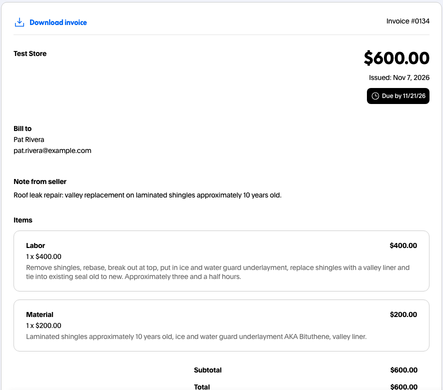
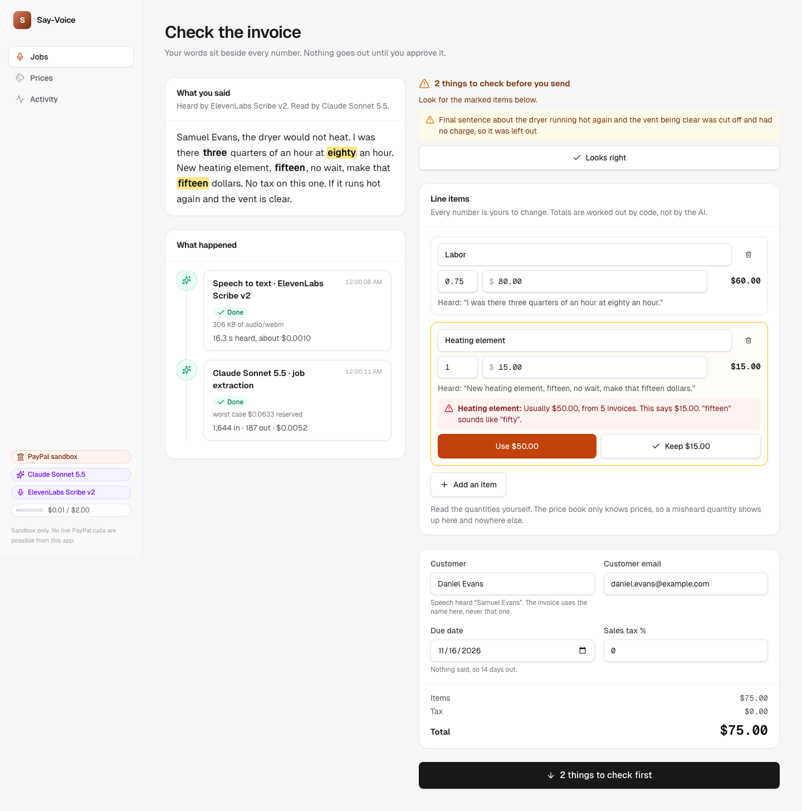

# Say-Voice

> **Said fifteen, usually fifty? Your PayPal invoices catch it.** Tradespeople say the job out loud in the van. When a price they said is far from what their own past PayPal invoices charged for that item, misheard or misspoken, the invoice waits and they pick the price. Code does every sum, and the invoice goes out once they approve the exact amount.

**Live demo:** https://say-voice.onrender.com · **Video:** https://youtu.be/eiHics6TfTc · **License:** MIT

**2.9 million US construction businesses have no employees, so the person who does the job also writes the bill** ([US Census Bureau, 2022 Nonemployer Statistics](https://www.census.gov/library/stories/2025/05/smallest-businesses.html)).

**For one-person trades who bill from the van.** One wrong number on an invoice can cost you the customer, so every price you say is checked against your own past PayPal invoices before it goes out. In testing, an AI model stated a wrong total on **6 of 20** spoken jobs ([how that was counted](docs/six-of-twenty.md)), so code also does every sum. A working roofer's **$600** roof repair went out through it, with what was fixed on every line:



**Why not Housecall Pro or Jobber?** Both have a price list of their own. What's different here is where the prices come from: your own past PayPal invoices, read with `GET /v2/invoicing/invoices`, and a spoken price is checked against them, so fifteen said for a part that's always been fifty stops before the customer sees it, whichever way it went wrong.

### How it compares

| | Say-Voice | Housecall Pro | Jobber |
|---|---|---|---|
| **A price book** | Built from your own past PayPal invoices. A price you say that's far from them, like fifteen for a part that's always been fifty, stops the invoice until you pick one. | Has a built-in price book, set up by hand or imported from a file, QuickBooks or Profit Rhino, and compares your prices with similar businesses ([source](https://www.housecallpro.com/features/price-book/)). We couldn't find one built from your past PayPal invoices, or one that checks a spoken price against them. Its voice invoicing release names cards, Apple Pay and Google Pay, not PayPal ([source](https://contractingbusiness.com/industry-news/press-release/55316860/housecall-pro-brings-ai-powered-voice-activated-invoicing-to-the-trades)). | Has a Products & Services list, its "default price list" ([source](https://help.getjobber.com/en/articles/products-services-list/)). We couldn't find one built from your past PayPal invoices, one that checks a spoken price against them, or PayPal. |
| **Nothing sent until you approve the exact amount** | Send waits for your tap on the exact total. Before sending, code compares PayPal's own total on the draft with the one you approved, and deletes the draft if they differ by a cent. | Has a final review before you send ([source](https://www.housecallpro.com/features/ai-team/invoices-by-hcp/)). We couldn't find a check that the total the customer is billed is the one you approved. | We couldn't find an approval step. It lists "Send invoice" as something the AI does ([source](https://help.getjobber.com/en/articles/jobber-ai-voice-and-chat-beta/)). |
| **Sums done by code** | Code adds every cent. The AI never states a total. | We couldn't find whether code or the AI does the math. | We couldn't find whether code or the AI does the math. |

"We couldn't find" means the linked page doesn't say it, not that the product can't do it. Sources: Housecall Pro's price book page, its Invoices by HCP page and its voice invoicing press release (16 Sep 2025), and Jobber's Products & Services List help article (updated 29 Oct 2026) and AI Voice and Chat (Beta) help article (updated 28 Oct 2026), all re-read on 2026-11-09.

**What's new next to other PayPal-invoicing entries.** Other entries in this hackathon also create, send and remind with PayPal Invoicing behind an approval step, and some flag a price the AI made up. What this one adds, as far as the pages we read show: you say the job out loud, the price book comes from your own past PayPal invoices with no setup, and a spoken price far from it (fifteen where it's always been fifty) is caught against it, with you deciding.



## Real jobs

Two jobs said out loud by the people who did them, read by ElevenLabs Scribe and Claude Sonnet, and sent as PayPal sandbox invoices on 7 Nov 2026. Customer names on the invoices are made up. Time from stop-record to sent wasn't measured, so it isn't claimed.

| | Roofer: roof leak repair | Appliance tech: dryer repair |
|---|---|---|
| **Sent** | $600.00, PayPal sandbox invoice #0134 | $472.03, PayPal sandbox invoice #0135 |
| **Lines right first time** | 2 of 2: Labor $400.00 flat, Material $200.00 | 2 of 2: the part $329.00 taxed, labor 2 h at $60.00 |
| **Checked before it went out** | Whether $400 was for the job or by the hour, since three and a half hours was said too (by the hour, the total would have been $1,600). The $200 material was one lump sum, not itemized. | Tax was said with no rate; speech spelled Iowa with a lowercase L ("lowa"), and it still found Iowa's rates from the state tables (7% was picked). The street address came through split by speech and was read back joined. The unnamed part was listed as "Dryer part" with a note to check. |

## Why this matters

The US has 2.9 million construction businesses with no employees ([Census, 2022](https://www.census.gov/library/stories/2025/05/smallest-businesses.html)). For them, the person who does the job also writes the bill. Getting paid is already hard, and voice invoicing exists, but the trades don't trust AI with the details:

- **56%** of US small businesses are owed money on unpaid invoices, $17.5K on average, and 47% have invoices more than 30 days overdue ([QuickBooks Small Business Late Payments Report 2025](https://quickbooks.intuit.com/r/small-business-data/small-business-late-payments-report-2025/), n=2,487, all industries).
- **49%** of construction payments are not made on time, and 61% of firms report cash-flow problems ([Levelset with QuickBooks Time, 2019](https://levelset.com/blog/2019-national-construction-payments-report), n=503, mostly contractors and subcontractors).
- **58%** of US residential contractors have little or no trust in the AI tools they use; only 11% trust them highly ([ServiceTitan 2026 State of AI in the Trades, via PHCP Pros](https://www.phcppros.com/articles/24198-servicetitan-report-finds-ai-adoption-accelerating-across-the-trades), n>1,000).

Say-Voice keeps the AI to listening. Code does the math, a price book catches wrong prices, and the tradesperson approves before PayPal sends anything. Speech to text can't be trusted with money on its own: in testing, every tool heard "sixty an hour" as "16 hour", and a model stated a wrong total on 6 of 20 clips ([method](docs/six-of-twenty.md)).

## What it does

- Press record and say the job: hours, parts, prices, tax. The record button is the first thing on the screen.
- Pick the customer from your contacts, before or after. Names never come from speech.
- ElevenLabs Scribe v2 writes it down and Claude pulls out the line items.
- Check the invoice. Your words sit beside every number, and everything is editable.
- The invoice says what the job was, where and when, with a description on every line, so the customer knows exactly what they paid for (see **Clear invoices and tax** below).
- The app holds the send until each worry is settled: a price far from what that item usually costs (fifteen said for a heating element shows "Usually $50.00, from 6 PayPal invoices, last $50.00", from the trade's own PayPal history; misheard or misspoken, the trade picks), a doubt the AI flagged, or a spoken amount with no line item. Each takes one tap. On day one, with no history for an item yet, a price said as one of the pairs speech mixes up (fifteen/fifty, thirteen/thirty, up to nineteen/ninety) still gets "Check this amount" with both readings, and no claim about a usual price.
- Press send, then approve the exact amount. Nothing reaches the customer before that.
- PayPal creates and sends the invoice. The result screen shows the real number and status, read back from PayPal.
- If it's unpaid, an agent drafts a reminder from what PayPal says is owed. You can ask it to add something; it writes what you ask, and code refuses any figure PayPal's invoice doesn't have (a "$25 late fee", say) before an approval card ever appears, and shows you what it refused. You read the corrected words and approve them before PayPal sends it.
- The customer's PayPal invoice comes from the trade's name (`invoicer.business_name`), not PayPal's default.
- When the customer pays, the job turns paid by itself, from PayPal's webhook.

The **Prices** page is the price book: demo items, then the trade's past PayPal invoices over them (read once in the background when the site starts, so a first visit's catch already says which PayPal invoices its price came from), then what that browser sent. **Learn from my PayPal invoices** reads the trade's own past invoices from PayPal (`GET /v2/invoicing/invoices`, a page at a time, then each one in full) and fills the book with them: each line says where its price came from ("from 3 PayPal invoices, last $85.00"), and PayPal's prices replace the demo ones for the same item. On the confirm screen a price far from that stops the send as usual, and one that merely differs from PayPal's last price is pointed out. It keeps the newest 20 from this trade name, because the sandbox account is shared with other apps, and leaves labor out, since a flat labor line can't be told from an hourly one without the words said around it. Every invoice sent with this app carries a private memo (`detail.memo`, which only the invoicer sees), so Learn skips them: other visitors' test jobs never become the trade's history. The demo trade's 18 past invoices are illustrative (made-up jobs and example.com customers, `src/lib/demo/past-invoices.ts`), put on the sandbox once with `npm run seed:history`.

If the app can't read a recording yet, you keep it. A refused upload, a lost signal or an empty AI or speech balance leaves the take in your browser with a clear message and **Try again**, even after a reload. Speech that was already heard isn't paid for twice. A recording with no words in it asks for a new one.

No mic? **Try a sample job** runs a real recorded job through the same screens, including a spoken price far from the trade's usual, to catch.

The trade's screens carry no developer chrome. Which PayPal (sandbox or mock), which models and today's AI spend sit behind one small **For judges** disclosure (the sidebar, or the phone's menu); the PayPal calls with their debug ids are under **Details** on each job and on **Activity**.

## Clear invoices and tax

A working roofer told us customers want to know exactly what was fixed. "Labor $400, Materials $200" says nothing about what job, where or when. So the invoice now carries:

- **A job summary, the job site and the date of service** at the top, in PayPal's note to the customer (it's in the invoice email too). The date is there only if you said one.
- **A description under every line**: the work done on the labor line, the parts and materials on the materials line.

A second Claude call (Haiku 5.5, its own prompt and mock fixture) writes these after the line items are read. It gets the transcript and each item with the words said around its price, first lists every part and material named anywhere in the note, then puts each one on the line that paid for it, so a material named while describing the work still lands on the materials line. It can only write words: code merges its text onto the lines that already exist, so it can't add, remove or change an item, a quantity or a price. Then code checks every word:

- Fillers ("um", "uh", "mm-hmm") are stripped.
- A link, or a number you didn't say that isn't that line's own quantity or price, blanks the text, and the screen says why.
- A word you didn't say is flagged on the confirm screen, so a made-up part or piece of work gets a look before it goes. Plurals, tenses and one-letter slips count as said. Words you type yourself are never flagged.
- A date goes on only when the words for it are in what you said.

The prompt is tuned on 12 made-up jobs from other trades, written by someone who hadn't seen it (`tests/dev/`): `AI_MODE=live npx tsx scripts/description-dev.ts` runs the real extraction and description step on each and scores whether every part and step named lands on its own line, with no unflagged made-up words. The two real jobs in `tests/heldout/` are only ever run once, at the end, never tuned on.

Everything is editable on the confirm screen, at phone size too. A generic line (Labor, Materials, Parts, Service call, Fee, Misc, Other and the like) with no description holds the send, and no tap waves it through: write a few words and it clears.

**Tax.** Say "plus tax" with no rate and the send waits for one. The check names the state it heard ("lowa", as speech to text writes Iowa, counts) and offers one-tap rates from a table in code: for Iowa, **6% state** and **7% state + local option**, plus **Other rate** and **No tax**. The rates come from the Tax Foundation's July 2026 table and the labels say to check your local rate. The AI never picks a rate: a rate it fills in that nobody said is dropped. Tax is per line: "plus tax" said after one item taxes that item only (a $329 part taxed, $120 of labor not: $23.03 tax at 7%), and each line has a Taxed switch. PayPal gets the tax on each item, and totals are worked out by code.

On PayPal: `detail.note` (summary, site, date; 4,000 characters), each item's `description` (cut at a word to fit 1,000) and `item_date`, and `tax` per item. The sandbox tests read all of it back from PayPal's API, and once from the page the customer sees.

## How PayPal is used

All PayPal calls go to the **sandbox** (`https://api-m.sandbox.paypal.com`); there is no live mode in the code. Every call shows on the in-app timeline with its HTTP status and PayPal `debug_id`.

| PayPal API | Endpoint(s) | Where and why |
|---|---|---|
| Invoicing v2, through **PayPal Agent Toolkit** (`@paypal/agent-toolkit` 1.11) | `create_invoice` (`POST /v2/invoicing/invoices`), `send_invoice` (`POST /v2/invoicing/invoices/{id}/send`) | The toolkit's invoicing tools create the invoice from the checked job and send it, after approval. The note says what, where and when; each item has a description, a date of service and its own tax |
| Invoicing v2 | `PUT /v2/invoicing/invoices/{id}` | Puts the due date on the toolkit's draft (its `create_invoice` has no payment term), and adds a late fee the owner set themselves |
| Invoicing v2 | `DELETE /v2/invoicing/invoices/{id}` | Deletes the draft if PayPal's total isn't the approved one, so nothing reaches the customer |
| Invoicing v2 | `GET /v2/invoicing/invoices/{id}` | Reads the invoice back, so the screen shows PayPal's number, status, amount due and payment |
| Invoicing v2, through PayPal Agent Toolkit | `send_invoice_reminder` (`POST /v2/invoicing/invoices/{id}/remind`) | Sends the reminder the person approved |
| Invoicing v2 | `POST /v2/invoicing/invoices/{id}/payments` | Records a deposit the owner says was paid, before the reminder |
| Invoicing v2 | `GET /v2/invoicing/invoices` | Reads the trade's past invoices into the price book, on request |
| Webhooks | `POST /v1/notifications/verify-webhook-signature` | Verifies PayPal's events. `INVOICING.INVOICE.PAID`, `REFUNDED` and `CANCELLED` update the job when `PAYPAL_WEBHOOK_ID` is set. The event only says something changed, so the status comes from a fresh read |

**Safety around money:** the send and the reminder go through a guard. It enforces a per-action cap, a daily cap, a payee allowlist and idempotency, and it waits for a person every time, whatever the amount. The allowlist means invoices can only go to made-up `@example.com` addresses: type a real one and the guard refuses, and the page says what to do instead. The toolkit has no spend limits or human gate of its own, so its tools only run inside the guarded, approved step. Before sending, the app compares PayPal's own total on the draft with the approved total; if they differ by a cent, it deletes the draft and says so. The server works out the open checks again, so skipping the screen gets a refusal. Every decision goes to a hash-chained, append-only audit log.

## How AI is used

| Where | Model | What it does |
|---|---|---|
| Speech to text | ElevenLabs Scribe v2 | Turns the recording into a transcript. The audio goes from the server to ElevenLabs and isn't stored here |
| Job extraction | Claude Sonnet 5.5 (`claude-sonnet-5-5`) | Reads the transcript into line items, quantities, prices and tax, and lists what it's unsure of |
| Job description | Claude Haiku 5.5 (`claude-haiku-5-5`) | Writes the job summary, job site, date of service and a description per line, in the speaker's words. Code guards every word |
| Reminder agent | Claude Haiku 5.5 (`claude-haiku-5-5`) | Reads the unpaid invoice from PayPal and writes the note the customer would get |

- **Code does the arithmetic**: money is integer cents, and line totals and the invoice total are computed in code, never stated by the AI. The rounding matches PayPal's, checked against real sandbox invoices.
- **The extraction prompt is frozen**: it was tested on sealed clips the prompt had never seen, and a unit test pins its hash.
- **Code checks the AI**: a separate parser finds the amounts in the transcript and warns when one has no line item, and the price book compares each price with what that item usually costs. When the AI doubts a price the book also knows, the book's line replaces the AI's words, so the warning reads the same on every run. Flat-rate labor (one Labor line with no hours said around it, or with hours said as how long it took: "about three hours, four hundred labor") isn't compared with the hourly rate. A rate said with it ("fifteen an hour") still is.
- **The agent can't talk its way past a limit**: code refuses a reminder for a paid invoice, a note with any figure other than what's owed, a note with a link, and a third reminder in a day. The check runs before the approval card and again after it, in case the customer paid in between. One proposal a run, so a no ends it.
- **Due dates** come from code: the extraction doesn't return one, so "net 30" or "due in two weeks" is read from the transcript, and the default is 14 days.
- **Cost control**: a hard daily spend cap (worst case reserved before every call) and per-IP rate limits. With the budget used up, a recording waits in the browser, and the sample job runs on a saved Claude reading and says so.
- **Mock mode**: without keys the app runs on clearly labelled fixtures for both speech and AI, so the whole flow works anywhere.

**Built with AI.** This project was built with **Claude Code** (Anthropic's coding agent), which wrote the code under human direction. It started from a shared starter kit that Claude Code also wrote. The product idea, scope and review were human decisions.

## What is this entry's and what is the shared kit's

Say-Voice started on 1 Nov 2026 from a shared starter kit (PayPal Agent Kit), also written with Claude Code, that other entries start from too. The line between the two:

**From the kit, shared:** the typed PayPal client (sandbox REST and an in-memory mock) and webhook verification (`src/lib/paypal`), the Guard with its caps, allowlist, approvals, idempotency and hash-chained audit log, and the agent loop (`src/lib/agent`), the Claude wrapper with the daily spend cap (`src/lib/ai`), the timeline, the UI components, the app shell, the JSON store and the demo-recorder template. Since the import, 14 kit files changed (166 lines added), only where this entry needed it: invoice update (PUT) and delete in both PayPal clients, the paid, refunded and cancelled invoice webhooks wired to the job, clearer AI errors, and the For judges disclosure in the shell.

**This entry's own:** everything under `src/lib/say` (speech, extraction, money in integer cents, the price book read from PayPal invoices, the sound-alike and quantity checks, the word checks on descriptions, tax, the guarded send, the reminder rules, paid status), the reminder agent and its guarded send and reminder tools (`src/agents`), the record, confirm, result, reminder and prices screens (`src/components/say`), the job, price and speech routes, the landing page, the demo script and most of the tests. The kit's example pages, example agent and unguarded PayPal money routes were removed.

## Architecture

```
Browser (Next.js 16 / React 19, Tailwind)
  │  MediaRecorder: microphone audio, uploaded when you stop
  │  SSE /api/events (live timeline)
  ▼
Next.js route handlers (Node)
  ├─ lib/say      speech, extraction, money, price book, checks, send, reminders, paid status
  ├─ agents       the reminder agent and its tools
  ├─ lib/agent    Guard: caps, allowlist, approvals, idempotency, audit
  ├─ lib/paypal   typed PayPal client: sandbox REST or in-memory mock
  ├─ lib/ai       Claude structured output and agent loop; daily spend cap
  ├─ webhooks     verify → ledger → timeline → job paid
  └─ .data/       local JSON: jobs, ledger, audit log, AI spend
```

## Run locally

Requirements: Node 24+ (developed on Node 26), npm.

```bash
npm ci
cp .env.example .env.local                  # optional: values here override ../../.env.shared
AI_MODE=mock PAYPAL_MODE=mock npm run dev   # no credentials needed
```

Open http://localhost:3000. For the real sandbox set `PAYPAL_MODE=sandbox`, `PAYPAL_CLIENT_ID` and `PAYPAL_CLIENT_SECRET`. For real AI set `ANTHROPIC_API_KEY` and `ELEVENLABS_API_KEY`. The microphone needs `localhost` or HTTPS.

Demo video: `DEMO_VOICE=take.m4a DEMO_PAYPAL_MODE=sandbox DEMO_AI_MODE=live npm run demo:record` records a 16:9 video (1920x1080, under 1:45) with live speech and AI. The clip is the microphone, so ElevenLabs really hears it, and `scripts/demo-finish.ts` cuts PayPal's checkout window in, cuts the waits (a model thinking, a page loading) and lays the voice under the record press. Output: `videos/demo-say-voice.mp4`. With no `DEMO_VOICE`, a macOS computer voice stands in as a placeholder.

Checks: `npm run check` (lint, typecheck, unit tests, build), `npm run test:e2e` (mock PayPal), `npm run test:e2e:sandbox` (sends real sandbox invoices). Set `E2E_BASE_URL` to run the sandbox flow against a deployed copy. `ENGINE=webkit npm run test:e2e:engines` runs the mock suite on another browser; `ENGINE` can also be `firefox`, `iphone` or `android`. Each of those uses a stand-in microphone, because only Chromium has a fake one.

The microphone test plays a computer-voice clip through Chromium's fake mic. macOS speech voices can't be redistributed, so the clip isn't in this repo: point `E2E_MIC_CLIP` at any spoken WAV, or the test skips and says why.

## Sandbox test accounts

Invoices go to fictional `example.com` contacts, so no buyer login is needed to send one. To open what the customer sees, use the link on the result screen. To pay one, press **Debit or Credit Card** there and pay as a guest with PayPal's test card `4111 1111 1111 1111`, any future date, any CVV. On a deployed copy the job turns paid within a few minutes. PayPal can't reach `localhost`, so a local copy finds out when you ask for a reminder. To set up your own:

1. In the PayPal Developer Dashboard → **Testing Tools → Sandbox Accounts**, use the default Business (seller) account.
2. Create a sandbox REST app under **Apps & Credentials → Sandbox** and copy its client ID and secret.
3. Optional: add a webhook for `https://<your-deploy>/api/paypal/webhooks` and set `PAYPAL_WEBHOOK_ID`.

## Deploy

Render Blueprint (`render.yaml`): New → Blueprint → this repo, then enter the secrets in the dashboard, including `ELEVENLABS_API_KEY`. Render provides the HTTPS the microphone needs.

## Limitations

- Sandbox only; no live payments are possible.
- US dollars, English speech, and one tax rate per invoice (each line is taxed or not).
- The state rate table is statewide rates only, plus Iowa's local option. Local rates elsewhere are typed in.
- The word check matches spelling, not meaning: a rewording of what you said (like "tear-off" for "remove") is flagged for a look even when it's fair.
- Sales tax is worked out per line, as PayPal does, so it can differ by a cent from tax on the whole sum.
- Recording is capped at two minutes, and the audio is uploaded when you stop, not streamed.
- A price can be misheard by speech to text or misspoken by the trade. The app can't tell which: it holds a price far from the trade's PayPal history and the trade decides, so a person still has to read the confirm screen.
- The price book needs two invoices for an item before it speaks up, and it checks prices, not quantities. A wrong quantity only gets caught by an AI flag or by reading it, and the confirm screen says so.
- There's no login. Jobs and learned prices belong to the browser that made them, so another device starts from the demo prices. Clearing site data does the same.
- A recording that couldn't be read stays in that browser only, one at a time. In a private window it lasts until the page closes.
- Local JSON storage: data resets on redeploy (fine for a demo, not for production).

## License

MIT, see [LICENSE](LICENSE). Third-party notice: [NOTICE](NOTICE).
